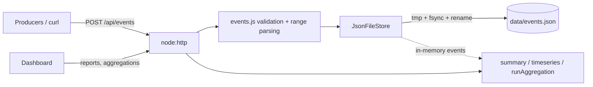

# Signal Events API

A self-contained product-analytics service: ingest events (single or batch,
idempotent), query them by validated date ranges, get summary and time-series
reports, define **named aggregations** (count / unique users / sum / avg / min /
max, optionally grouped), and explore everything in a built-in HTML dashboard
with charts. Data is persisted to a JSON file with atomic writes.

**Zero runtime or dev dependencies** — only Node.js built-ins.

- Default URL: <http://127.0.0.1:3002> (dashboard) — API under `/api`
- Requires Node.js **18.18+** (Node 20 LTS recommended)
- All times are **UTC**.

---

## Quick start

```powershell
cd signal-events-api
npm start                 # http://127.0.0.1:3002
npm test                  # node:test suite against real HTTP endpoints
npm run dev               # auto-restart on file changes
```

| Variable | Default | Description |
|---|---|---|
| `HOST` | `127.0.0.1` | Bind address (localhost-only by default). |
| `PORT` | `3002` | Listen port. |
| `DATA_FILE` | `data/events.json` | JSON data file; relative to project root. Created on first start. |
| `BODY_LIMIT_BYTES` | `262144` | Max request body (413 beyond). |
| `MAX_BATCH` | `500` | Max events per ingestion request. |
| `MAX_EVENTS` | `50000` | Retention cap; oldest-received events are evicted first. |
| `REQUEST_TIMEOUT_MS` | `15000` | Max time to receive a request. |
| `LOG_REQUESTS` | `true` | JSON access log per request. |

Invalid configuration aborts startup.

---

## Data model

### Event (input)

| Field | Required | Rules |
|---|---|---|
| `name` | yes | `^[a-z][a-z0-9_.:-]{0,63}$` e.g. `page.view`, `checkout:completed` |
| `timestamp` | no | ISO-8601 date-time **with timezone** (`Z` or `±hh:mm`), real calendar date; not >5 min in the future, not >365 days old. Defaults to server receive time. Stored normalized to UTC. |
| `userId` | no | string 1–128 chars, or null |
| `value` | no | finite number (used by `sum/avg/min/max`), or null |
| `properties` | no | flat object, ≤20 keys matching `^[A-Za-z_][A-Za-z0-9_]{0,39}$`; values string(≤500) / number / boolean / null |
| `eventId` | no | client idempotency key `^[A-Za-z0-9_.:-]{1,100}$`; repeats are counted as `duplicates` and not stored again |

Stored events additionally get `id` (UUID) and `receivedAt`.

### Named aggregation

```json
{ "name": "revenue-by-plan",          // ^[a-z][a-z0-9-]{1,49}$, unique
  "description": "Revenue split",     // optional, ≤200 chars
  "eventName": "purchase",            // optional filter (null = all events)
  "metric": "sum",                    // count | unique_users | sum | avg | min | max
  "groupBy": "property.plan" }        // optional: name | userId | hour | day | property.<key>
```

Three defaults are created on first start: `events-per-day`, `top-events`,
`active-users`. Up to 100 aggregations may be defined.

---

## Date ranges

All reporting/list endpoints accept `from` and `to`:

- Format: `YYYY-MM-DD` or ISO-8601 date-time with timezone.
- Interval is **half-open** `[from, to)`. A date-only `to` includes that whole
  day (`to=2026-03-08` → `2026-03-09T00:00:00Z`).
- Defaults: `to` = now + 5 min (accepted clock skew), `from` = `to` − 7 days.
- Rejected with **400**: unparseable or impossible dates (`2026-02-30`),
  datetimes without timezone, `from >= to`, span > **366 days**, and time-series
  requests producing > **2000 buckets** (e.g. hourly over 3 months).
- The resolved range is echoed in responses as `range: { from, to }`.

---

## API contract

Success: `{ "data": … }`. Error: `{ "error": { "code", "message", "details?": [{ field, message }] } }`.
Bodies must be `Content-Type: application/json`.

| Method | Path | Query | Description |
|---|---|---|---|
| GET | `/` | | Dashboard |
| GET | `/health` | | Liveness + stored event count |
| POST | `/api/events` | | Ingest one event (object) or batch `{ "events": [...] }` |
| GET | `/api/events` | `from,to,name,userId,limit(1-500,100),offset` | Raw events, newest first, with `page` |
| GET | `/api/reports/summary` | `from,to,name` | Totals, unique users, Σ value, breakdown by event name |
| GET | `/api/reports/timeseries` | `from,to,name,interval(hour\|day)` | Zero-filled event counts per bucket |
| GET | `/api/aggregations` | | List named aggregations |
| POST | `/api/aggregations` | | Create (201, `Location`); 409 if name exists |
| GET | `/api/aggregations/:name` | | Definition |
| DELETE | `/api/aggregations/:name` | | Delete (204) |
| GET | `/api/aggregations/:name/run` | `from,to` | Execute over a range |

Unknown query parameters → 400.

### Ingestion semantics

- Validation is **all-or-nothing**: if any event in a batch is invalid, nothing
  is stored and `details` lists each problem as `events[i].field`.
- Response: `201 { data: { accepted, duplicates, evicted, ids } }`
  (`200` when every event was a duplicate).

### Aggregation results

- No `groupBy` → `{ "value": 29.875, "events": 2 }`
- `groupBy: hour|day` → `{ "groups": [{ "key": "<bucket ISO start>", "value", "events" }] }` zero-filled
- Other `groupBy` → `{ "groups": [...top 100 by value desc], "totalGroups" }`; missing keys grouped as `"(none)"`
- `sum` of no values is `0`; `avg/min/max` of no values is `null`.

### Error codes

| HTTP | code | When |
|---|---|---|
| 400 | `validation_error` | Invalid fields/params/ranges, empty or oversized batch |
| 400 | `invalid_json` | Unparseable body |
| 404 | `not_found` | Unknown route or aggregation |
| 405 | `method_not_allowed` | Wrong method (`Allow` header set) |
| 409 | `conflict` / `limit_reached` | Duplicate aggregation name / >100 aggregations |
| 413 | `payload_too_large` | Body over `BODY_LIMIT_BYTES` |
| 415 | `unsupported_media_type` | Non-JSON body |
| 500 | `internal_error` | Unexpected failure (logged server-side only) |

---

## curl examples

(Windows PowerShell: use `curl.exe` from Git Bash/WSL or escape quotes.)

```bash
BASE=http://127.0.0.1:3002

# Single event
curl -s -X POST $BASE/api/events -H 'Content-Type: application/json' \
  -d '{"name":"page.view","userId":"u1","properties":{"path":"/pricing"}}'

# Batch with idempotency keys and explicit timestamps
curl -s -X POST $BASE/api/events -H 'Content-Type: application/json' -d '{"events":[
  {"name":"purchase","userId":"u1","value":49.5,"eventId":"order-1001","properties":{"plan":"pro"},"timestamp":"2026-10-01T09:05:00Z"},
  {"name":"purchase","userId":"u2","value":10,"eventId":"order-1002","properties":{"plan":"free"}}]}'

# Reports
curl -s "$BASE/api/reports/summary?from=2026-09-25&to=2026-10-02"
curl -s "$BASE/api/reports/timeseries?from=2026-10-01T00:00:00Z&to=2026-10-02T00:00:00Z&interval=hour&name=page.view"
curl -s "$BASE/api/events?name=purchase&userId=u1&limit=20"

# Named aggregation: revenue by plan
curl -s -X POST $BASE/api/aggregations -H 'Content-Type: application/json' \
  -d '{"name":"revenue-by-plan","eventName":"purchase","metric":"sum","groupBy":"property.plan"}'
curl -s "$BASE/api/aggregations/revenue-by-plan/run?from=2026-09-01&to=2026-10-02"
curl -s -X DELETE $BASE/api/aggregations/revenue-by-plan -o /dev/null -w '%{http_code}\n'

# Invalid range (from after to) => 400
curl -s "$BASE/api/reports/summary?from=2026-10-02&to=2026-09-01"
```

---

## Dashboard

Open <http://127.0.0.1:3002>: range presets (24h hourly, 7d, 30d, custom
dates), event-name filter, summary cards, an SVG bar chart of events over time,
a per-event breakdown table, a named-aggregation runner (renders a chart for
time-grouped aggregations, a table for grouped ones, or a single big number),
forms to define aggregations and send test events, and a recent-events table.
One static file, no external assets.

---

## Architecture

```
src/
  server.js   entrypoint: config, listen, graceful shutdown
  config.js   env parsing + validation
  app.js      routing + handlers (createApp() used by tests)
  events.js   domain: event/aggregation validation, date ranges, bucketing, metrics
  store.js    JsonFileStore: in-memory state + serialized atomic persistence
  http.js     JSON/HTML responses, bounded body parsing, errors, security headers
public/index.html   dashboard
tests/api.test.js   node:test suite over real HTTP
```



Reports scan the in-memory event list (O(n) per request), which is fast for
the default 50k retention cap. For larger volumes, move storage to SQLite /
a columnar store and pre-aggregate.

## Data persistence

- Whole document `{ version, events, aggregations }` is held in memory and
  persisted on every mutation via a single serialized queue: write unique temp
  file → `fsync` → atomic `rename`. Memory is only updated after the write
  succeeds; a crash leaves the previous complete file.
- Transient Windows `EPERM/EBUSY` on rename is retried.
- Corrupt/mis-shaped data file → service refuses to start (never overwrites it).
- `eventId` deduplication is rebuilt from the file on restart.
- Retention: once `MAX_EVENTS` is exceeded, the oldest-received events are
  evicted (reported as `evicted` in the ingestion response).
- Each ingest rewrites the file; batch events for throughput. Single process
  only — do not point multiple instances at one file.

## Security

- Localhost bind by default, no auth built in (front with an authenticating
  proxy before wider exposure). No secrets are used or stored.
- Strict validation of every field, query parameter, and date; body size and
  batch limits; JSON content-type required; request/header timeouts.
- Dashboard: per-request nonce CSP (`default-src 'none'`, `connect-src 'self'`),
  all data rendered via `textContent`/DOM/SVG APIs — never `innerHTML` — so
  event names, properties and user ids cannot inject markup or script.
- `nosniff`, `X-Frame-Options: DENY`, `Referrer-Policy: no-referrer`,
  COOP/CORP, `no-store`; no CORS headers; no stack traces in responses.

## Testing

`npm test` covers ingestion (single, batch, defaults, normalization of
offsets to UTC), idempotency, all-or-nothing validation of many invalid cases
(names, impossible/timezone-less/future/too-old timestamps, nested properties,
unknown fields, 413/415/invalid JSON/batch limits), date-range validation
(bad formats, reversed, >366 days, too many buckets, defaults, inclusive
date-only `to`), summary/timeseries/list correctness, aggregation CRUD and
execution for every grouping style, persistence across restart, atomic writes,
retention eviction, and refusal to start on corrupt data.

## Compatibility

- **Supported runtime: Node.js 18.18+** (developed and tested on Node 18.18.0; also works on Node 20/22). `package.json` declares `"engines": { "node": ">=18.18" }`.
- Uses only built-ins available in Node 18: `node:http`, `node:fs/promises`, `node:crypto`, `node:test`, global `fetch` (tests only), `server.closeIdleConnections()`.
- `npm run dev` uses `node --watch`, which is experimental on Node 18 (prints a warning) and stable on Node 20+.
- `.env` files are not loaded automatically; set variables in the shell, or on Node 20.6+ use `node --env-file=.env src/server.js`.
- The Docker image uses `node:20-alpine` (current LTS); the source itself does not require Node 20.
## Deployment (local)

```bash
docker build -t signal-events-api .
docker run --rm -p 127.0.0.1:3002:3002 -v signal-data:/data signal-events-api
```

Non-root user, `/data` volume, `/health` `HEALTHCHECK`. Without Docker:
`npm start` under a process manager (systemd, pm2, NSSM).